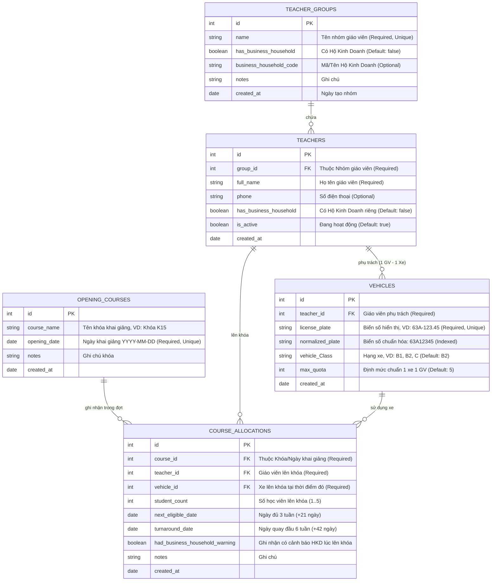

# Phase 1 Data Model: Hệ Thống Quản Lý Xe, Giáo Viên & Khai Giảng Sông Tiền

**Feature**: `001-quan-ly-khai-giang`  
**Date**: 2026-11-16

## 1. Sơ đồ Quan hệ Thực thể (ER Diagram)

---

## 2. Chi tiết các Thực thể & Ràng buộc Dữ liệu

### 2.1. `teacher_groups` (Nhóm Giáo Viên)
| Trường | Kiểu | Bắt buộc | Ràng buộc / Mô tả |
|--------|------|----------|-------------------|
| `id` | INTEGER | Có | Primary Key, Auto Increment |
| `name` | TEXT | Có | Độ dài 2–100 ký tự, không trùng lặp |
| `has_business_household` | INTEGER (0/1) | Có | `1`: Đã có Hộ Kinh Doanh, `0`: Chưa có Hộ Kinh Doanh |
| `business_household_info` | TEXT | Không | Tên/Mã số hộ kinh doanh (nếu có) |
| `notes` | TEXT | Không | Ghi chú thêm |
| `created_at` | TEXT (ISO Date) | Có | Mặc định ngày tạo `YYYY-MM-DD` |

### 2.2. `teachers` (Giáo Viên)
| Trường | Kiểu | Bắt buộc | Ràng buộc / Mô tả |
|--------|------|----------|-------------------|
| `id` | INTEGER | Có | Primary Key, Auto Increment |
| `group_id` | INTEGER | Có | Foreign Key tham chiếu `teacher_groups(id)` (`ON DELETE CASCADE`) |
| `full_name` | TEXT | Có | Họ và tên giáo viên (2–100 ký tự) |
| `phone` | TEXT | Không | Số điện thoại liên hệ |
| `has_business_household` | INTEGER (0/1) | Có | `1`: Giáo viên đã có Hộ Kinh Doanh, `0`: Chưa có |
| `is_active` | INTEGER (0/1) | Có | Mặc định `1` (đang hoạt động) |
| `created_at` | TEXT (ISO Date) | Có | Mặc định ngày tạo |

> **Quy tắc kiểm tra Hộ Kinh Doanh (`hasEffectiveBusinessHousehold`)**:
> Khi lên khóa, nếu **Nhóm giáo viên chưa có Hộ Kinh Doanh** HOẶC **Giáo viên chưa có Hộ Kinh Doanh** (tùy cấu hình hoặc khi cả 2 đều `0`), hệ thống phát thông báo cảnh báo: *"Cảnh báo: Giáo viên / Nhóm giáo viên chưa có Hộ Kinh Doanh!"*.

### 2.3. `vehicles` (Xe Đào Tạo)
| Trường | Kiểu | Bắt buộc | Ràng buộc / Mô tả |
|--------|------|----------|-------------------|
| `id` | INTEGER | Có | Primary Key, Auto Increment |
| `teacher_id` | INTEGER | Có | Foreign Key tham chiếu `teachers(id)` |
| `license_plate` | TEXT | Có | Biển số hiển thị (VD: `63A-123.45`), Unique |
| `normalized_plate` | TEXT | Có | Tự động tạo bằng `license_plate.replace(/[^a-zA-Z0-9]/g, '').toUpperCase()` |
| `vehicle_class` | TEXT | Không | Hạng đào tạo (`B1`, `B2`, `C`...), mặc định `B2` |
| `max_quota` | INTEGER | Có | Định mức học viên tối đa mỗi chu kỳ 6 tuần (Mặc định: `5`) |
| `created_at` | TEXT (ISO Date) | Có | Mặc định ngày tạo |

### 2.4. `opening_courses` (Khóa / Ngày Khai Giảng)
| Trường | Kiểu | Bắt buộc | Ràng buộc / Mô tả |
|--------|------|----------|-------------------|
| `id` | INTEGER | Có | Primary Key, Auto Increment |
| `course_name` | TEXT | Có | Tên đợt khai giảng (VD: `Khóa K01 - Tháng 11`) |
| `opening_date` | TEXT (ISO Date) | Có | Ngày khai giảng định dạng `YYYY-MM-DD`, Unique |
| `notes` | TEXT | Không | Ghi chú |
| `created_at` | TEXT (ISO Date) | Có | Mặc định ngày tạo |

### 2.5. `course_allocations` (Bản Ghi Lên Khóa)
| Trường | Kiểu | Bắt buộc | Ràng buộc / Mô tả |
|--------|------|----------|-------------------|
| `id` | INTEGER | Có | Primary Key, Auto Increment |
| `course_id` | INTEGER | Có | Foreign Key tham chiếu `opening_courses(id)` |
| `teacher_id` | INTEGER | Có | Foreign Key tham chiếu `teachers(id)` |
| `vehicle_id` | INTEGER | Có | Foreign Key tham chiếu `vehicles(id)` |
| `student_count` | INTEGER | Có | Số lượng học viên lên khóa: `1 <= student_count <= remaining_quota` |
| `next_eligible_date` | TEXT (ISO Date) | Có | Tự động tính: `opening_date + 21 ngày` (3 tuần) |
| `turnaround_date` | TEXT (ISO Date) | Có | Tự động tính: `opening_date + 42 ngày` (6 tuần) |
| `had_business_household_warning` | INTEGER (0/1) | Có | Lưu vết việc lên khóa khi chưa có Hộ Kinh Doanh |
| `notes` | TEXT | Không | Ghi chú |
| `created_at` | TEXT (ISO Date) | Có | Mặc định thời điểm tạo |

---

## 3. Các Trạng thái Nghiệp vụ Dẫn xuất (Computed Domain States)

1. **Trạng thái Định mức Giáo viên tại ngày xét `referenceDate` (mặc định là ngày khai giảng đang chọn hoặc ngày hiện tại)**:
   - `activeAllocations`: Các bản ghi `course_allocations` của giáo viên có `opening_date <= referenceDate` và `turnaround_date > referenceDate` (chưa hết 6 tuần).
   - `usedQuota = SUM(activeAllocations.student_count)`.
   - `remainingQuota = max(0, vehicle.max_quota - usedQuota)` (Ví dụ: `5 - 3 = 2` học viên).
   - `lastOpeningDate`: Ngày `opening_date` lớn nhất trong `activeAllocations`.
   - `nextAllowedDate`: `lastOpeningDate + 21 ngày` (nếu có `lastOpeningDate`).
   - `canEnrollNow`:
     - `false` nếu `remainingQuota == 0` (Đã đủ 5 học viên, chờ ngày quay đầu 6 tuần).
     - `false` nếu `lastOpeningDate` tồn tại và `referenceDate < nextAllowedDate` (Còn `remainingQuota` học viên nhưng chưa đủ 3 tuần kể từ lần lên khóa trước).
     - `true` nếu `remainingQuota > 0` và (`!lastOpeningDate` hoặc `referenceDate >= nextAllowedDate`).

2. **Trạng thái "Danh sách cần chú ý" của Nhóm giáo viên**:
   - Duyệt các `opening_courses` theo `opening_date DESC` (từ mới nhất về cũ nhất, chỉ xét các khóa có `opening_date >= group.created_at`).
   - Đếm số khóa liên tiếp từ khóa mới nhất mà nhóm có `SUM(student_count) == 0`.
   - Nếu `consecutiveMissedCourses >= 3` $\Rightarrow$ `needsAttention = true`, trả về mảng `missedCourseDates` (3 ngày khai giảng gần nhất đã bỏ qua).

